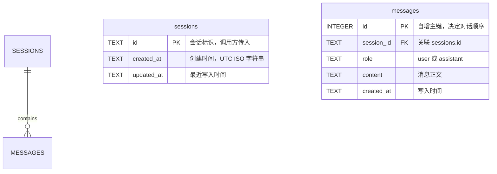

# 智能式AI对话机器人

用 Python 编写的大模型对话程序：既可以在命令行里聊天，也可以作为 FastAPI 服务提供 HTTP 接口，支持多轮会话、流式输出与 SQLite 会话持久化。

配置统一由 `pydantic-settings` 管理，所有可变参数均可通过 `.env` 覆盖，代码中不硬编码任何密钥。项目用 `uv` + `pyproject.toml` 统一管理依赖与工具配置。

## 目录结构

```
cli-chatbot/
├── pyproject.toml              # 项目元数据、依赖、pytest/ruff 配置（唯一配置入口）
├── uv.lock                     # uv 锁文件，记录精确版本
├── .env.example                # 环境变量示例（提交到仓库）
├── README.md
├── src/
│   └── chatbot/
│       ├── core/config.py          # Settings + get_settings()：pydantic-settings 配置类
│       ├── models/schemas.py       # 7 个 Pydantic 请求/响应模型，每个字段带 description
│       ├── services/llm.py         # 大模型调用（普通 + 流式）、单词讲解专用提示词
│       ├── repositories/session_store.py   # SQLAlchemy 2.0 ORM 会话存储
│       ├── api/app.py              # FastAPI 应用 + 路由 + 静态页面挂载
│       ├── static/index.html       # 前端聊天界面
│       └── cli.py                  # 命令行入口（uv run chatbot）
└── tests/
    ├── conftest.py                 # 共享 fixture：假模型客户端、临时数据库
    ├── unit/                       # 单元测试：配置、模型调用、存储层
    └── integration/                # 接口测试：chat / stream / sessions
```

## 配置说明

所有可变参数都定义在 `src/chatbot/core/config.py` 的 `Settings` 里，运行时通过 `CHATBOT_*` 环境变量或 `.env` 覆盖，代码中不硬编码。

| 环境变量 | 默认值 | 说明 |
| --- | --- | --- |
| `CHATBOT_API_KEY` | 无（必填） | 大模型服务 API Key，使用 `SecretStr` 接收，打印配置时自动脱敏 |
| `CHATBOT_BASE_URL` | `https://api.openai.com/v1` | OpenAI 兼容接口地址 |
| `CHATBOT_MODEL` | `gpt-4o-mini` | 模型名称 |
| `CHATBOT_TEMPERATURE` | `0.7` | 采样温度，超出 0~2 抛 `ValidationError` |
| `CHATBOT_SYSTEM_PROMPT` | `你是一个乐于助人的中文助手。` | 系统提示词 |
| `CHATBOT_MAX_HISTORY_MESSAGES` | `20` | 每次请求携带的历史消息条数上限 |
| `CHATBOT_DB_PATH` | `chat.db` | SQLite 数据库文件路径 |

```bash
copy .env.example .env   # Windows PowerShell
# 编辑 .env，填入 CHATBOT_API_KEY
```

## 快速开始

```bash
uv sync                                          # 安装全部依赖，创建 .venv
uv run chatbot                                   # 命令行对话
uv run uvicorn chatbot.api.app:app --port 8000   # 起 HTTP 服务
uv run pytest                                    # 运行测试
uv run ruff check .                              # 代码检查
```

命令行对话示例：

```
$ uv run chatbot
你：你好
助手：你好！有什么可以帮你的？
你：exit
再见。
```

回复边生成边打印（模型用 `stream=True`），结束后只补一个换行，不会出现空行堆积。

## HTTP 服务（FastAPI）

```bash
uv run uvicorn chatbot.api.app:app --host 127.0.0.1 --port 8000
```

- http://127.0.0.1:8000 → 网页版聊天界面（水墨风）
- http://127.0.0.1:8000/docs → 自动生成的 Swagger 接口文档

前端只负责展示和收集输入，对话、历史、流式全部走下面同一套 HTTP 接口。

### 普通对话 `POST /chat`

```bash
curl -X POST http://127.0.0.1:8000/chat ^
  -H "Content-Type: application/json" ^
  -d "{\"session_id\":\"u1\",\"message\":\"你好\"}"
```

```json
{"session_id":"u1","reply":"模型的回复"}
```

`session_id` 由调用方提供；第一次使用该 ID 时创建会话，之后同一 ID 的请求自动带上历史。不同 `session_id` 的会话互不影响。空消息返回 `400`。

### 流式对话 `POST /chat/stream`

请求体与 `/chat` 相同，响应为逐块返回的纯文本。

```bash
curl -N -X POST http://127.0.0.1:8000/chat/stream ^
  -H "Content-Type: application/json" ^
  -d "{\"session_id\":\"u1\",\"message\":\"用一句话介绍 Python\"}"
```

流式输出结束后，完整的用户消息与助手回复会在同一会话里留存。

### 会话管理

| 接口 | 作用 |
| --- | --- |
| `GET /sessions` | 返回全部会话 ID 列表 `{"sessions":["u1","u2"]}` |
| `GET /sessions/{session_id}/messages` | 按时间顺序返回消息记录 |
| `DELETE /sessions/{session_id}` | 删除会话及其全部消息（数据库级联） |

### 单词讲解 `POST /study/word`

```bash
curl -X POST http://127.0.0.1:8000/study/word ^
  -H "Content-Type: application/json" ^
  -d "{\"word\":\"apple\"}"
```

```json
{"word":"apple","explanation":"n. 苹果；例句：She ate an apple after lunch."}
```

专门的提示词让模型按「词性 + 中文释义 + 英文例句」作答，适合做单词卡片。

## 数据库设计

会话数据存放在 SQLite 文件（默认 `chat.db`，已加入 `.gitignore`），通过 **SQLAlchemy 2.0 ORM** 访问，共两张表。



| 要素 | 说明 |
| --- | --- |
| ORM 模型 | `Session` 与 `Message`，继承 `DeclarativeBase`，定义在 `session_store.py` 顶部 |
| 级联删除 | `Message.session_id` 带 `ForeignKey(ondelete="CASCADE")`，删除会话时消息自动清理 |
| 角色约束 | `CheckConstraint("role IN ('user','assistant')")` 数据库层面限制取值 |
| 索引 | `idx_messages_session(session_id, id)` 支持按会话顺序读取 |
| 外键开启 | SQLite 默认关闭外键，每次连接自动执行 `PRAGMA foreign_keys = ON` |
| 访问层 | `SessionStore` 类封装全部 ORM 操作，接口层只通过依赖注入拿实例，不直接接触 ORM |

## 单元测试

测试使用 `pytest` + FastAPI `TestClient`，通过 `app.dependency_overrides` 注入假模型客户端，不联网也能跑。

```bash
uv run pytest -q
uv run ruff check .
```

| 文件 | 覆盖内容 |
| --- | --- |
| `tests/unit/test_config.py` | 默认值解析、温度范围校验、`SecretStr` 脱敏 |
| `tests/unit/test_llm.py` | 假客户端断言模型参数、流式增量拼接 |
| `tests/unit/test_session_store.py` | ORM 层全方法：顺序、隔离、trim、级联删除、持久化 |
| `tests/integration/test_api_chat.py` | 同会话连续对话、不同会话历史隔离、单词讲解、空消息 400 |
| `tests/integration/test_api_sessions.py` | 会话列表、消息记录、删除、不存在返回 404 |
| `tests/integration/test_api_stream.py` | 模型收到 `stream=True`、流式逐块返回、完整回复落库 |
