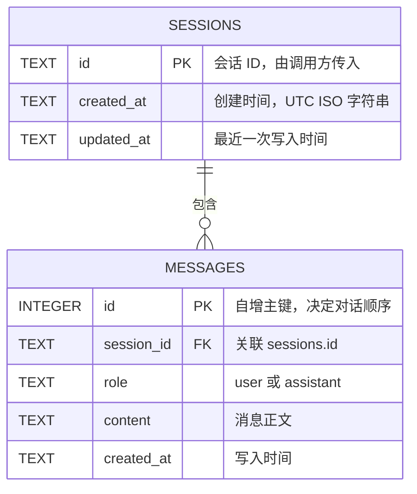

# 智能式AI对话机器人

用 Python 编写的大模型对话程序：既可以在命令行里聊天，也可以作为 FastAPI 服务提供 HTTP 接口与网页界面。
会话历史保存在 SQLite 中，重启服务后仍可继续；所有可变参数通过 `.env` 覆盖，代码中不硬编码密钥。

项目按 `src` 布局组织，依赖与工具配置统一放在 `pyproject.toml`，由 [uv](https://docs.astral.sh/uv/) 管理环境。

## 目录结构

```
cli-chatbot/
├── src/chatbot/
│   ├── __init__.py
│   ├── core/config.py            # 配置模型与 get_settings()
│   ├── models/schemas.py         # 全部 Pydantic 模型（请求 / 响应 / 消息）
│   ├── services/llm.py           # 大模型调用封装（普通与流式）
│   ├── repositories/session_store.py  # SQLite 会话存储，SQL 只在这一层
│   ├── api/app.py                # FastAPI 应用与路由
│   ├── cli.py                    # 命令行入口
│   └── static/index.html         # 网页版聊天界面
├── tests/
│   ├── conftest.py               # 假模型客户端、临时数据库夹具
│   ├── unit/                     # 配置、模型调用、存储的单元测试
│   └── integration/              # HTTP 接口集成测试
├── pyproject.toml                # 依赖、pytest、ruff 统一配置
├── uv.lock                       # 锁定依赖版本
├── .env.example
└── README.md
```

## 快速开始（uv）

```bash
uv sync                        # 按 uv.lock 创建 .venv 并安装依赖
copy .env.example .env         # Windows；macOS/Linux 用 cp
# 编辑 .env，填入 CHATBOT_API_KEY（可选改 base_url / model）
uv run chatbot                 # 启动命令行对话
```

对话示例：

```
命令行对话机器人（模型 glm-4-flash），输入 exit 退出。
你：你好，帮我写一个 Python 冒泡排序
AI：...
你：exit
再见。
```

回复边生成边打印（`stream=True`），结束后只补一个换行。

## 配置说明

所有可变参数定义在 `core/config.py` 的 `Settings`，通过 `CHATBOT_*` 环境变量或 `.env` 覆盖。

| 环境变量 | 默认值 | 说明 |
| --- | --- | --- |
| `CHATBOT_API_KEY` | 无（必填） | 大模型服务 API Key，`SecretStr` 存储，打印配置时自动脱敏 |
| `CHATBOT_BASE_URL` | `https://api.openai.com/v1` | OpenAI 兼容接口地址 |
| `CHATBOT_MODEL` | `gpt-4o-mini` | 模型名称 |
| `CHATBOT_TEMPERATURE` | `0.7` | 采样温度，超出 0~2 抛 `ValidationError` |
| `CHATBOT_SYSTEM_PROMPT` | `你是一个乐于助人的中文助手。` | 系统提示词 |
| `CHATBOT_MAX_HISTORY_MESSAGES` | `20` | 最多保留的历史消息条数（含 system） |
| `CHATBOT_DB_PATH` | `chat.db` | SQLite 数据库路径，测试用临时文件或 `:memory:` |

## HTTP 服务

```bash
uv run uvicorn chatbot.api.app:app --host 127.0.0.1 --port 8000
```

- http://127.0.0.1:8000 ：网页版聊天界面（会话列表、流式输出、新建/切换/删除会话）
- http://127.0.0.1:8000/docs ：自动生成的接口文档

### 普通对话 `POST /chat`

```bash
curl -X POST http://127.0.0.1:8000/chat ^
  -H "Content-Type: application/json" ^
  -d "{\"session_id\":\"u1\",\"message\":\"你好\"}"
```

```json
{"session_id":"u1","reply":"模型的回复"}
```

同一 `session_id` 自动延续历史，不同会话互不影响；空消息返回 `400`。

### 流式对话 `POST /chat/stream`

请求体与 `/chat` 相同，模型侧使用 `stream=True`，响应为逐块返回的纯文本。
流式结束后，用户消息与完整回复会在同一会话中落库。

```bash
curl -N -X POST http://127.0.0.1:8000/chat/stream ^
  -H "Content-Type: application/json" ^
  -d "{\"session_id\":\"u1\",\"message\":\"用一句话介绍 Python\"}"
```

### 会话管理

| 接口 | 作用 |
| --- | --- |
| `GET /sessions` | 已有会话 ID 列表：`{"sessions":["u1"]}` |
| `GET /sessions/{session_id}/messages` | 按顺序返回消息记录 |
| `DELETE /sessions/{session_id}` | 删除该会话及其消息，成功返回 `204` |

会话不存在时 `GET` / `DELETE` 返回 `404`。

### 学习功能 `POST /study/word`

```bash
curl -X POST http://127.0.0.1:8000/study/word ^
  -H "Content-Type: application/json" ^
  -d "{\"word\":\"apple\"}"
```

返回 `word` 与 `explanation`（词性 + 中文释义 + 英文例句及翻译）。

## 数据库设计

会话数据存放在 SQLite 文件（默认 `chat.db`，已加入 `.gitignore`），共两张表：



- `sessions.id` 是主键，删除会话时通过外键 `ON DELETE CASCADE` 一并删除消息
- `messages.role` 带 `CHECK` 约束，只允许 `user` / `assistant`
- 索引 `idx_messages_session(session_id, id)` 支持按会话顺序读取
- 建表语句与全部 SQL 位于 `src/chatbot/repositories/session_store.py`，接口层不直接接触数据库

## 单元测试

```bash
uv run pytest
uv run ruff check .
```

测试通过 `dependency_overrides` 注入假模型客户端，并用 `tmp_path` 下的临时数据库隔离用例，全程离线、不需要真实 Key。

| 文件 | 覆盖内容 |
| --- | --- |
| `tests/unit/test_config.py` | 默认值；温度越界抛 `ValidationError`；`SecretStr` 不打印明文 |
| `tests/unit/test_llm.py` | 传给模型的 `model`、`temperature`、`messages` 与 `stream=True`；增量文本拼接 |
| `tests/unit/test_session_store.py` | 消息顺序、会话隔离、截断、级联删除、重开连接后数据仍在 |
| `tests/integration/test_api_chat.py` | 连续对话、会话隔离、单词讲解、空消息 400 |
| `tests/integration/test_api_sessions.py` | 会话列表与消息记录、清空、404 |
| `tests/integration/test_api_stream.py` | 流式逐块返回、完整回复落库 |
